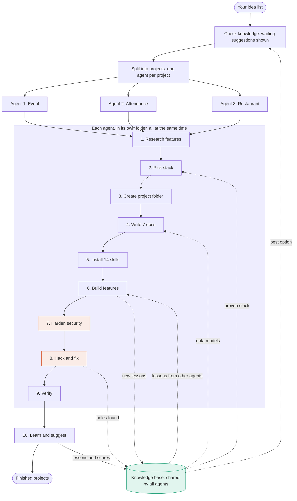
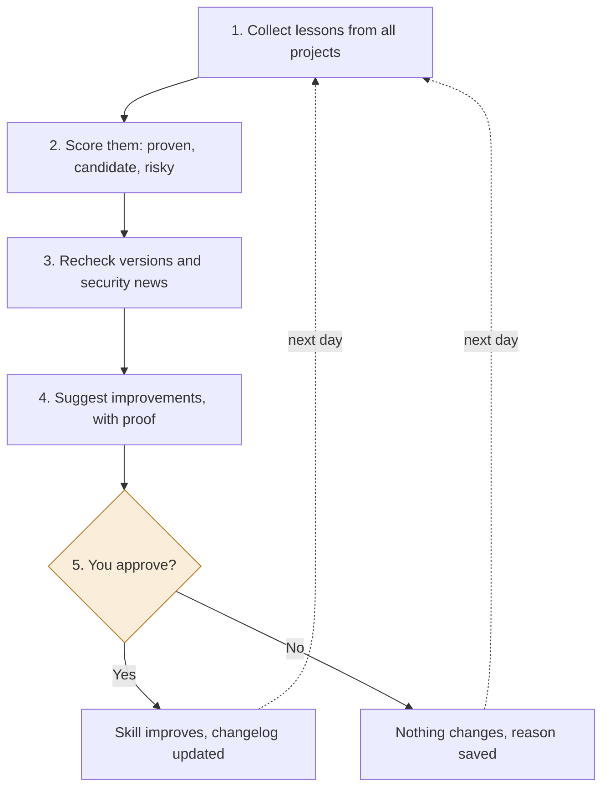

# Automation skill — workflow

The complete flow, step by step. The diagrams render on GitHub and in most Markdown viewers; for a picture you can open directly, use `workflow.html` in a browser.

## 1. Complete workflow

## 2. Daily update (the skill improves day by day)

## 3. What each box does

| Box | What happens | Output |
|---|---|---|
| Your idea list | You give one or more project ideas and, if you like, the platform | — |
| Check knowledge | Shows improvements waiting for your approval and the latest learning report; asks the platform once if missing | Confirmed plan (5 lines) |
| Split into projects | One clean name, folder and agent per project; agents run at the same time | One agent per project |
| 1. Research features | Roles, modules, features and functions from real products and open-source systems, reusing feature patterns learned before | Prioritised feature list with IDs |
| 2. Pick stack | Best proven stack from the knowledge base, then live version check (newest stable, at least 14 days old) | Stack table + ADR |
| 3. Create project folder | Own folder, own ports, own git repo; refuses to nest projects | Project skeleton |
| 4. Write 7 docs | PRD → DESIGN_SYSTEM → ARCHITECTURE → DATABASE → API → AGENTS → README, using proven data models | Complete specification |
| 5. Install 14 skills | Setup, feature development, auth & security, MCP, integrations, testing, debugging, compound ask/plan/analysis/work/fix, PR reviewer | `.claude/skills/` tailored to the stack |
| 6. Build features | Setup → security foundation → data layer → each feature through ask, plan, analyze, work, review → integrations → MCP → tests; lessons shared with other agents | Working app with tests |
| 7. Harden security | Every control checked: login safety, roles and ownership, validation, headers, CSRF, rate limits, CAPTCHA, IP bans, uploads, secrets | Hardening checklist done |
| 8. Hack and fix | Attacks its own localhost build (login, data access, injection, bypasses, races, uploads, leaks, scans), fixes everything, each attack becomes a test; vulnerability classes are sent to the other agents | SECURITY_REPORT with no open Critical/High |
| 9. Verify | Fresh install works, all tests green, validator passes | Ready project |
| 10. Learn and suggest | Collects lessons from all projects, scores them, writes the report, proposes improvements | Updated knowledge + suggestions |
| Finished projects | Short report per project, plus what was learned and what waits for your approval | — |
| Knowledge base | Proven data structures, stack results, security lessons and bug fixes, scored by real results | Best-option suggestions |
| Daily update | Collect → score → recheck → suggest → your approval → skill improves; repeats every day | Daily report |
